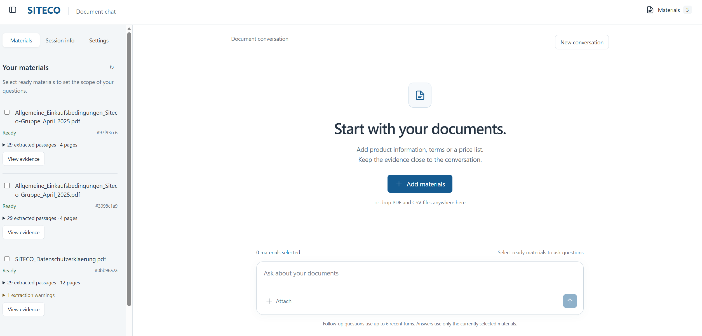
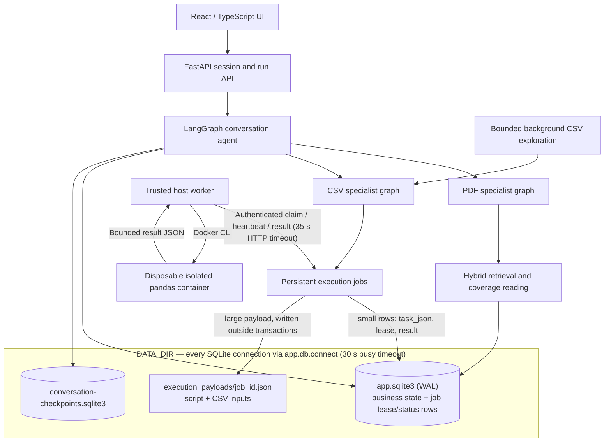
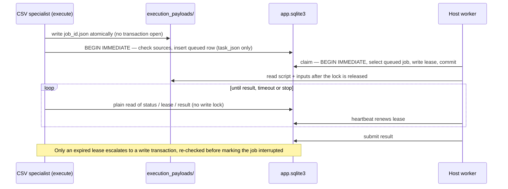
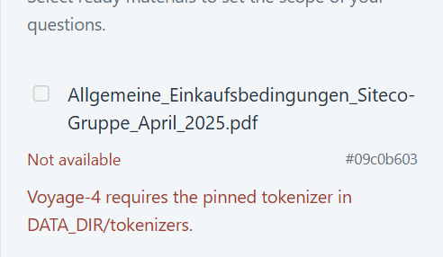

# SITECO Document Chat

## 1. Demo

Upload documents, ask questions, and inspect the sources behind each answer.
The demo combines a React chat interface with a FastAPI retrieval backend.
The demo now supports pdf and csv files. 
All evaluation data comes from https://www.siteco.de/metanavigation/downloads

[](siteco_demo.mp4)

[Watch the demo (MP4)](siteco_demo.mp4). The video is stored with Git LFS; to download it after cloning, install Git LFS and run `git lfs pull`. Sample PDF and CSV documents used in testing are included in [test_data/](test_data/); upload them through the application to try it yourself.

The video shows the original demo. The current backend uses persistent sessions,
a LangGraph conversation agent, PDF/CSV specialist graphs and isolated Python
computation. The existing UI supports chat, citations, tables, charts and recovery;
the visual redesign and independent developer interface are future work.

**Current status (2026-10-14):** G background exploration is implemented in the
working tree. Cross-platform regression, real-provider probes, browser smoke
testing and final code review have recorded results; the review fix has targeted
regression coverage. Documentation/interface handoff is available; the final
delivery summary remains the next step. G changes are not committed. Building
this checkout includes them; building only commit `4c05c32` does not. The normal
application instance has not been upgraded; temporary validation instances were
stopped. See [plan.md](plan.md) and [stage-g-log.md](stage-g-log.md) for exact scope.

**SQLite / CSV worker update (2026-10-15, uncommitted):** unified SQLite busy
timeout, WAL for `app.sqlite3`, and execution payloads moved out of the database
into files. Not yet verified end to end with Docker and a real worker, and existing
databases need an `execution_jobs` migration before CSV execution works. Details
and known issues: [CHANGELOG.md](CHANGELOG.md).

## 2. Architecture



CSV execution job lifecycle (lock-sensitive steps):



- **Conversation agent:** resolves intent and references, enforces session source
  scope, coordinates PDF/CSV tasks and publishes answers/artifacts. It owns
  conversational context; specialists do not maintain separate chat histories.
- **PDF specialist:** factual retrieval, coverage reading and topic comparison.
  Hybrid search combines lexical and Voyage vector retrieval with optional
  reranking. Top K hits are not full-document coverage; gaps remain explicit.
  Citations retain document versions and source locations.
- **CSV specialist:** plans filtering, sorting, aggregation and joins, generates
  Python for isolated execution, validates results and performs bounded review
  when needed. Numbers come from computation, not model arithmetic. Original
  strings and row identities preserve identifiers such as leading zeros.
- **Execution boundary:** a trusted host worker pulls authenticated backend jobs
  and starts pinned pandas containers. Containers have no network, application
  keys or Docker socket and have bounded resources. Neither the backend nor
  generated scripts receive Docker control; only the host worker does.
- **Persistence:** `app.sqlite3` owns documents, sessions, rules, tasks, artifacts,
  receipts and execution-job metadata; `conversation-checkpoints.sqlite3` stores
  graph checkpoints. Originals and tokenizer assets live beside the databases. The
  worker has its own instance/receipt store and never accesses the backend
  database directly.
- **SQLite concurrency:** all backend connections go through `app.db.connect`
  with one 30 s busy timeout, so lock contention behaves the same in every module
  (non-blocking try-locks and the 1 s startup check are deliberate exceptions).
  Startup switches `app.sqlite3` to WAL with `synchronous=NORMAL`, so readers do
  not wait behind writers; back up the `-wal`/`-shm` files with the database or
  stop the backend first. Storage errors still return 503 `storage_unavailable`
  and are logged by the `siteco.storage` logger.
- **Execution payloads:** generated scripts and CSV inputs (up to 64 MiB) are
  stored as `DATA_DIR/execution_payloads/<job_id>.json`, not in SQLite. Write
  transactions touch only small rows (`task_json`, lease, result), and the worker
  reads the payload after its lease commits. Session/source purges delete payload
  files. Startup removes files whose job row no longer exists. Permanent document
  deletion removes the rows immediately, and the related files on the next startup.
- **Recovery:** session history has no 24-hour expiry. The browser stores only the
  current session pointer and UI state. Interrupted conversation runs require
  explicit resume; durable receipts and stable identities prevent duplicate
  publication. Foreground model calls are capped at six per interaction round.
- **Background exploration (G):** deterministic CSV overview, at most three
  candidates and one precomputation per session/document version. Its lifetime
  budget is three model calls and two isolated executions, unchanged by restart
  or resume. It yields to foreground requests and can be disabled/stopped through
  the API. Results stay outside chat/context until selected. No exploration UI
  has been added yet.

This is a single-user local application with one backend process. Session
boundaries are not multi-user authentication. Architecture decisions:
[decisions-design.md](decisions-design.md). API contracts and examples:
[ui-developer-handoff.md](ui-developer-handoff.md).

## 3. Run the application

Run commands from the repository root. Examples use Windows PowerShell; Linux
uses `.venv/bin/python` and equivalent environment setup.

### Prerequisites and configuration

- Docker with Linux containers; the pandas runner is validated on Linux/amd64.
- Host Python 3.12 for the worker, including when the UI/backend run in Docker.
- Node.js 24 only when running/building the frontend outside Docker.
- Your own generation and embedding credentials.

Create `.env` from [.env.example](.env.example) if it does not already exist:

```powershell
if (!(Test-Path .env)) { Copy-Item .env.example .env }
py -3.12 -m venv .venv
.venv/Scripts/python.exe -m pip install -r backend/requirements.lock.txt
```

Edit `.env` locally. Environment variables override its values.

| Setting | Purpose |
| --- | --- |
| `GEMINI_API_KEY` | Default generation provider credential |
| `GROQ_API_KEY` | Required if selecting Groq instead |
| `VOYAGE_API_KEY` | PDF embeddings and optional reranking |
| `GENERATION_PROVIDER` | `gemini` (default) or `groq` |
| `GEMINI_GENERATION_MODEL`, `GROQ_GENERATION_MODEL` | Generation model selection |
| `EXECUTION_IMAGE` | Complete immutable `sha256:...` identity of the built runner |
| `EXECUTION_WORKER_TOKEN` | Strong random secret shared by backend and host worker |
| `DATA_DIR` | Local Python runtime path; default `data/runtime` |
| `HOST_DATA_DIR` | Docker host runtime path; default `./data/runtime` |
| `HOST_PORT`, `FRONTEND_PORT` | Published backend/frontend ports; defaults `8000` / `8080` |
| `COMPOSE_PROJECT_NAME` | Docker instance name; default `document-chat` |

Keep credentials out of frontend variables, source control and shared logs. Use
`docker compose config --quiet` for validation; ordinary `config` output can
expand secrets. Missing credentials permit startup but do not enable provider
calls. The worker reads its token from its environment, **not from `.env`**.

### Build the CSV runner (both startup options)

```powershell
docker build -t siteco-csv-runner:local -f runner/Dockerfile .
docker image inspect --format '{{.Id}}' siteco-csv-runner:local
```

Set `.env`'s `EXECUTION_IMAGE` to the full printed ID and configure
`EXECUTION_WORKER_TOKEN`. Use the same image ID and token for the worker.
Rebuild the runner after changes to its lock file or `backend/app/csv_runtime.py`.
Pandas is installed inside the runner, not in the backend or host environment.

### Option A: Docker frontend and backend

Create the directory specified by `HOST_DATA_DIR` first; Compose rejects missing
bind directories. For the default path:

```powershell
New-Item -ItemType Directory -Force data/runtime | Out-Null
docker compose config --quiet
docker compose build
docker compose run --rm --no-deps backend python -m app.prepare_tokenizer /app/runtime/tokenizers
docker compose up -d --wait --wait-timeout 60
```

On Linux, the runtime directory must be writable by container UID/GID
`10001:10001`. Tokenizer preparation requires network access on first setup.
Open [http://127.0.0.1:8080](http://127.0.0.1:8080), then start the host worker below.
**Compose manages only the frontend/backend containers, not the host worker.**

### Start the host worker

In a separate terminal at the repository root, enter the **same token** configured
in backend `.env`, without placing it in command history:

```powershell
$workerSecret = Read-Host 'Backend EXECUTION_WORKER_TOKEN' -AsSecureString
$env:EXECUTION_WORKER_TOKEN = [System.Net.NetworkCredential]::new('', $workerSecret).Password
.venv/Scripts/python.exe scripts/run_python_worker.py --backend http://127.0.0.1:8000 --work-dir data/python-worker --image sha256:YOUR_IMAGE_ID
```

Replace `sha256:YOUR_IMAGE_ID` with the complete ID above, and change the port if
`HOST_PORT` differs. Keep this terminal running. Stop the worker with Ctrl+C;
stop the Docker application with `docker compose stop`.

Use a persistent, instance-specific worker directory. Without a worker, uploads
and PDF questions can work, but new CSV computations cannot complete. Execution
limits and recovery details: [runner/README.md](runner/README.md).

### Option B: Local backend and frontend

Use the same `.env`, Python environment and runner setup. Docker is still required
for CSV execution, even though the web application runs locally.

Backend terminal, using the default `DATA_DIR`:

```powershell
.venv/Scripts/python.exe scripts/prepare_voyage_tokenizer.py data/runtime/tokenizers
.venv/Scripts/python.exe -m uvicorn app.main:create_app --factory --app-dir backend --host 127.0.0.1 --port 8000
```

Frontend terminal:

```powershell
npm ci --prefix frontend
npm run dev --prefix frontend
```

Start the host worker in a third terminal as above, then open
[http://127.0.0.1:5173](http://127.0.0.1:5173). The Vite proxy targets backend port
8000. Do not run local and Docker backends on the same port or runtime directory
simultaneously. If `DATA_DIR` changes, prepare its `tokenizers` subdirectory.

### Updating an existing Docker instance

Application source is copied into images. `docker compose restart` does **not**
load updated source. After checking the target instance/configuration and backing
up its data, rebuild and recreate the services:

```powershell
docker compose up -d --build --wait --wait-timeout 60
```

Restart the host worker when its code/configuration changes. If a runner rebuild
changes its image ID, update both backend configuration and the worker command.
Saved runs retain their original behavior configuration and may require it to resume.

Databases created before the 2026-10-15 SQLite update still have the old
`execution_jobs.payload` column, and no automatic migration exists yet. Until one
is added, back up the data directory and rebuild that table, which holds only
transient job state. Otherwise CSV execution fails with `storage_unavailable`.
See [CHANGELOG.md](CHANGELOG.md).

For a separate demo instance, use different project names, ports, runtime
and worker directories, and tokens. Backup, migration and permission details:
[deployment.md](deployment.md). A healthy container proves service availability,
not end-to-end model or calculation correctness.

## 4. Features, manual testing and current limits

The existing UI supports:

- PDF/CSV upload, processing states, citations and source previews.
- Persistent session chat, natural-language source restrictions and purpose rules.
- PDF questions, coverage summaries and cross-document analysis with explicit gaps.
- CSV filtering, sorting, aggregation, joins, result tables and basic charts.
- PDF-derived product identifiers driving exact CSV matching and calculations.
- Follow-up filtering/chart reuse, clarification, stop and explicit resume.
- Gemini/Groq settings, Top K and optional Voyage reranking.

For a manual smoke test, upload a sample PDF, ask a factual question and open its
citation. Upload a CSV and request a row count or calculation with explicit numeric
format, units and missing-value handling. Check the numbers against the source,
ask a follow-up, and try stop/resume. Restart the backend and check that the same
session remains available. The API health endpoint is `/api/health`.

Background exploration controls/results and developer observations are API-only:
`/api/sessions/{sid}/explorations` and
`/api/developer/sessions/{sid}/explorations/{id}`. Exploration is enabled by default
for new imports and may make bounded model calls. Disable it per session with
`PUT /api/sessions/{sid}/explorations/settings` and `{"enabled":false}`. Existing
materials on startup receive an overview without automatic paid continuation.
See [API examples](ui-developer-handoff.md).

Current boundaries:

- Native-text PDFs only; no OCR. Coverage and semantic checks can return partial
  results; source coordinates are not uniformly fine-grained.
- Upload limit 20 MiB, up to 10 active files, PDFs up to 50 pages, CSVs up to 20,000
  rows. CSV supports UTF-8 and BOM-marked UTF-16 with comma/semicolon/tab separators;
  arbitrary encoding selection is not implemented.
- Result tables are bounded to 20,000 rows, 100 columns and 16 MiB. Charts are
  basic bar/line/scatter previews; large-file export is not implemented.
- Model planning, summaries and review do not prove arbitrary semantic correctness.
  Ambiguous joins/fields/formats require clarification. No silent provider fallback.
- Exploration controls and developer observations remain API-only. UI redesign
  and a dedicated developer mode are not implemented; handoff contracts and real
  examples are in [ui-developer-handoff.md](ui-developer-handoff.md).

**Tokenizer troubleshooting:** `voyage-4-tokenizer.json` must be under the active
`DATA_DIR/tokenizers`. Local `DATA_DIR` and Docker `HOST_DATA_DIR` identify different
startup paths; prepare the tokenizer in the directory actually used by that mode.
For Docker, the mounted directory appears as `/app/runtime` inside the container.



## 5. Validation and historical evaluation

Recorded G validation (2026-10-13–14):

| Check | Result and scope |
| --- | --- |
| Windows / Linux backend full suites | Each: **571 passed, 15 skipped, 10 subtests passed** |
| Opt-in real Docker isolation / pandas | **15 passed**, covering the skipped cases separately |
| Frontend | TypeScript/production build passed; **10 browser tests passed** with mocked APIs |
| Real background exploration | Gemini + host worker + pandas passed; 11,386 rows / 18 columns independently checked |
| Real application smoke | Docker UI/backend + host worker; PDF upload/citation preview, CSV sum, stop and reload passed |
| Final code review | One P2 preemption side-effect fixed and reviewed; **37 affected tests passed** afterward |

The full suites and real smoke precede the final preemption fix; they were not
rerun after it. The smoke used five generation calls and two CSV execution
attempts (first script failed, bounded repair succeeded). A browser assertion
was corrected and the same saved session reused without repeating paid answers.
These are scoped checks, not proof of arbitrary model/code correctness or a
deployment of the normal instance. Exact commands and receipts: [G log](stage-g-log.md).

F real-provider validation remains a cross-fix resumed session. Historical
partial answers remain partial; it was not a clean final-code run from an empty
database. Preserve those qualifications when reusing [F evidence](stage-f-log.md).

Run backend tests after installing the development lock file:

```powershell
.venv/Scripts/python.exe -m pip install -r backend/requirements-dev.lock.txt
.venv/Scripts/python.exe -m pytest -q
docker build --target test -t siteco-tests -f backend/Dockerfile .
npm ci --prefix frontend
npm run build --prefix frontend
```

Docker executor tests are opt-in; commands are in [runner/README.md](runner/README.md).
Real-provider probes under `scripts/probe_stage_*.py` can incur API charges and
write independent receipts under `data/`. Ordinary tests do not replace those checks.

### Original demo evaluation (historical)

These scores belong to the original architecture and recorded evaluation commit.
They have not been rerun as an evaluation of the current LangGraph system.


First evaluation: 12 conversation turns and 7 PDF retrieval queries.

- Strict answer pass: **3/12**; required-fact coverage: **10/40**.
- Evidence recall: lexical **9/12**, vector **12/12**, RRF **10/12**, reranked **11/12**.

Results include provider failures and blocked turns. The later order-ID punctuation
fix is locally tested; these scores remain the original pre-fix results.

Open the [report](eval/results/m50/run-20260927-ab-01/report.html) locally, or read
its [Markdown version](eval/results/m50/run-20260927-ab-01/report.md).

Recompute saved scores without API calls:

```sh
python eval/summarize_m50.py eval/results/m50/run-20260927-ab-01
```

For a live evaluation, use the recorded evaluation commit, matching source
materials and your own Gemini/Voyage keys. Commands and configuration:
[Evaluation README](eval/README.md).

## 6. Repository guide

| Path | Responsibility |
| --- | --- |
| `backend/app/main.py`, `*_api.py` | Application wiring and HTTP interfaces |
| `backend/app/conversation_runs.py`, `conversation_context.py` | Main graph, durable runs, bounded context and summaries |
| `backend/app/agent_protocol.py`, `sessions.py`, `artifacts.py` | Typed task/result contracts, source scope and persistent artifacts |
| `backend/app/pdf_specialist.py`, `pdf_analysis.py`, `pdf_reading.py` | PDF specialist paths and coverage reading |
| `backend/app/csv_specialist.py`, `csv_exploration.py` | CSV graph and bounded background exploration |
| `backend/app/db.py` | Shared SQLite connection helper and busy timeout |
| `backend/app/execution_jobs.py`, `host_worker.py`, `python_executor.py` | Durable pull jobs, file-backed payloads, trusted host control and isolation |
| `backend/app/csv_runtime.py`, `runner/` | Container-side pandas helpers, image and locked dependencies |
| `backend/app/documents.py`, `processing.py`, `*_parsing.py`, `*_store.py` | Document lifecycle, ingestion and structured storage |
| `backend/app/retrieval/`, `embeddings.py`, `voyage.py`, `reranking.py` | Retrieval, embedding admission and optional reranking |
| `backend/app/generation.py`, `config.py`, `runtime_*.py` | Model adapters and configuration |
| `frontend/src/` | React chat, settings, result and source previews |
| `backend/tests/`, `frontend/tests/`, `tests/` | Backend, browser and tracing tests |
| `scripts/` | Host worker launcher, tokenizer preparation and stage probes |
| `test_data/`, `assets/`, `siteco_demo.mp4` | Sample documents, screenshots and original demo |
| `eval/` | Historical evaluation protocols, results and scoring scripts |
| `compose.yaml`, `.env.example` | Deployment and configuration template |

Architecture decisions: [decisions-design.md](decisions-design.md). Execution plan
and stage evidence: [plan.md](plan.md). Uncommitted change log:
[CHANGELOG.md](CHANGELOG.md). Deployment and data migration:
[deployment.md](deployment.md). Next UI/developer implementation entry points:
[ui-developer-handoff.md](ui-developer-handoff.md).
